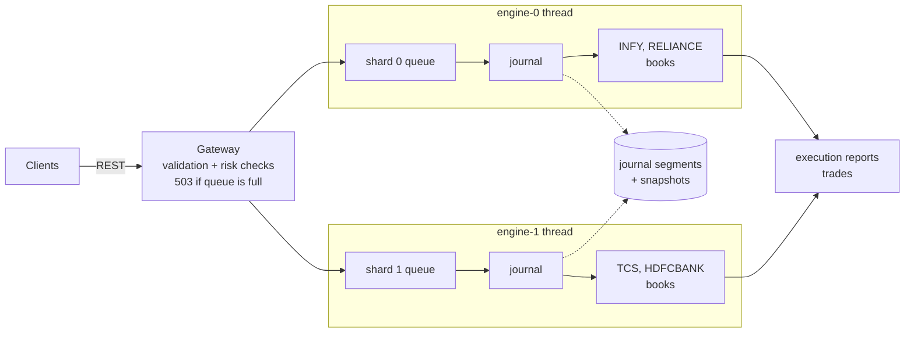
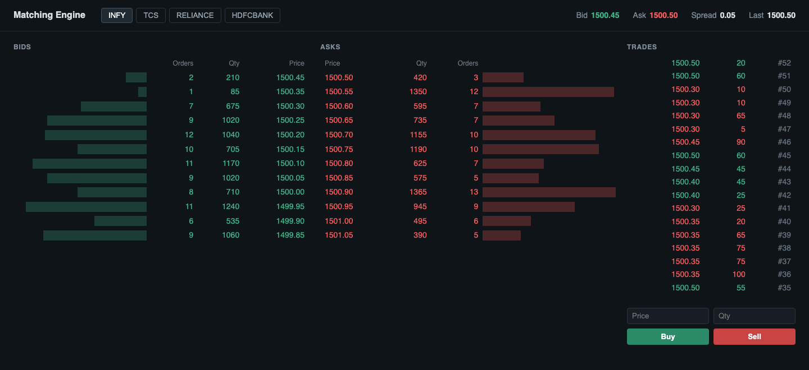

# Trade Order Matching Engine

[](https://github.com/RutvikMendpara/Trade-Order-Matching-Engine/actions/workflows/ci.yml)

A small stock exchange matching engine in Java 21. It takes buy and sell orders, keeps an order book per symbol and matches them using price-time priority.





## What it does

- Limit and market orders, partial fills
- Cancel and amend (reducing qty keeps your place in the queue, anything else loses it)
- Time in force: GTC, DAY, IOC, FOK
- Self-trade prevention
- Pre-trade risk checks: tick size, max order size, 10% price band, duplicate client order id
- Multiple symbols, each book owned by a single thread
- Journal of every command + periodic snapshots, so a restart rebuilds the books exactly
- Backpressure: when an engine queue is full the API answers 503 instead of queueing forever
- REST API and a small web page showing the depth and trades

## Run it

```
./mvnw spring-boot:run
```

Open http://localhost:8080. To get random orders flowing so the page isn't empty:

```
./mvnw spring-boot:run -Dspring-boot.run.arguments=--engine.demo=true
```

## API

```
POST   /orders              new order
PATCH  /orders/{id}         amend   {"quantity": 50, "price": 1500.10}
DELETE /orders/{id}         cancel
GET    /orders/{id}         latest execution report
GET    /book/{symbol}       top 5 levels (?depth=n for more)
GET    /trades/{symbol}     recent trades
```

```
curl -X POST localhost:8080/orders -H 'Content-Type: application/json' -d '{
  "clientId": "alice", "clientOrderId": "a1", "symbol": "INFY",
  "side": "BUY", "type": "LIMIT", "price": 1500.05, "quantity": 100
}'
```

## Matching rules

1. A buy at P matches asks at P or lower, lowest first. A sell matches bids at P or higher, highest first.
2. Trades happen at the resting order's price.
3. Same price, oldest order fills first.
4. Leftover limit qty rests in the book, leftover market qty is cancelled.

## Design decisions

**One thread per symbol (well, per shard of symbols).** A book is only ever touched by the thread that owns it. No locks in the matching code, no contention, and the order of events is just the order they come off the queue, so the same input always gives the same trades. That's also what makes replay work. To scale to thousands of symbols you add shards, not locks. Even reading the book for market data goes through the queue rather than reading from another thread.

**Prices are `long` paise, not `double`.** 0.1 + 0.2 isn't 0.3 in floating point, and money that's off by a rounding error is a real bug. Rupees only exist at the edge (JSON), everything inside is whole paise.

**Journal before acknowledging.** Each command is written to the journal before it's applied, and the client only gets its response after the journal is flushed. So anything a client was told about can be rebuilt after a crash. A half-written last line (crash mid-write) was never acknowledged, so recovery just drops it.

**Snapshots.** Replaying the whole journal gets slower every day. Every 1M commands per symbol the book is written to a snapshot file (with a CRC, written to a temp file and renamed), the journal rolls to a new segment, and old segments get deleted. Restart = newest valid snapshot + the journal after it. The two newest snapshots are kept, so a corrupt one just falls back to the one before.

**Data structures.** Bids and asks are `TreeMap<Long, PriceLevel>` (sorted, O(log n) to find a level). Each level is a doubly linked list of orders, so FIFO is O(1) at both ends, and an order can unlink itself in O(1) on cancel. Order id to order is a small open-addressing `long` map I wrote after JFR showed `HashMap<Long, Order>` boxing ids was ~15% of allocations.

## Tests

```
./mvnw test
```

- One test per matching rule, plus edge cases (empty book, exact fill, cancel after fill, IOC/FOK, self-trade...)
- Property tests with jqwik: 1000 random sequences of new/cancel/amend, and after every step it checks the book is never crossed, quantity is conserved (submitted = filled + resting + cancelled) and FIFO holds inside each level
- Replay and snapshot tests: restart gives identical books, a restored book trades exactly like one that never restarted, a corrupt snapshot falls back to the previous one
- 8 threads submitting 40k orders at once, nothing lost or duplicated
- API tests with MockMvc

## Benchmarks

Apple M4 (10 cores), 24 GB, JDK 21.0.10, G1 unless it says otherwise. Ranges are across runs, the tail moves around a lot.

JMH (`./mvnw test-compile exec:exec@jmh`), book holding 10k orders per side:

| Operation | Time |
|---|---|
| add + cancel | 32 ns |
| match one order + refill | 51 ns |
| sweep 5 levels (500 fills) + refill 500 | 19.3 us |

Load test (`./mvnw test-compile exec:exec@load`), random mix of limits, markets, cancels and amends:

| Run | Throughput | p50 | p99 | p99.9 |
|---|---|---|---|---|
| Order book only, 5M commands, 1 thread | 5.8 - 7.4M/sec | 0.08 us | 0.4 us | 1 - 3 us |
| Full engine with journal, 1 in flight per producer (round trip) | 315 - 340k/sec | 8 us | 21 - 27 us | 38 - 54 us |
| Full engine with journal, 256 in flight per producer | 3.8 - 5.1M/sec | 160 - 180 us | 0.75 - 1 ms | 4 - 7 ms |
| same, generational ZGC | 4.5M/sec | 180 us | 0.6 ms | 1.2 ms |

Restart (`./mvnw test-compile exec:exec@restart`), 5M commands of history, 1.15M orders resting:

| | Restart time |
|---|---|
| Replay the whole journal | 1.85 - 2.06 s |
| Snapshot + replay last 0.5M commands | 0.38 - 0.39 s |

Writing a snapshot of ~1M orders pauses that shard for 160 - 300 ms. That's the trade-off of snapshotting on the engine thread. A real system would take snapshots from a replica that follows the journal, so the primary never pauses.

### Where the tail latency comes from

With 256 orders in flight per producer (1,024 total), p50 is about 170 us. That's just queueing: 1,024 orders in flight at ~5M/sec is about 200 us of waiting (Little's law). The engine isn't slow, it just has a queue in front of it.

p99.9 was the interesting one. Before any tuning it jumped between 2.5 and 18 ms from run to run. The GC log showed G1 young pauses of 11 - 14 ms. When the JVM pauses, every one of those 1,024 in-flight orders waits for the pause, so one or two pauses are enough to own the top 0.1%.

What I did about it:

1. **JFR allocation profiling.** Per command, the whole engine allocated 845 bytes. Top sites: journal encoding (`String.join`, `Long.toString`, the charset encoder, ~30%), `Long` boxing for order ids in `HashMap<Long, Order>` (~15%) and `HashMap.resize`.
2. **Removed that garbage.** Journal lines are now written straight into a reused byte buffer. Orders live in a primitive `long` map. **845 -> 480 bytes per command** for the engine, **85 -> 30** for the book alone. Throughput went up (3.8 - 4.4M -> 3.8 - 5.1M/sec) and the round trip p99.9 went from 46 - 64 us to 38 - 54 us.
   - My first version of the map used an identity hash, since order ids are sequential. With linear probing that put every new id into one big cluster and add+cancel went from 36 ns to 3 us. Fibonacci hashing fixed it and ended up faster than the original `HashMap`.
3. **Less garbage alone doesn't kill the tail.** With G1 the 256-in-flight p99.9 settled around 4 - 7 ms instead of jumping to 18, but pauses still happen. Switching to generational ZGC (pauses well under 1 ms) brought it to **~1.2 ms**, at the cost of slower single-threaded book speed (ZGC's load barriers).

In production I'd: keep in-flight bounded (the gateway already rejects when a queue is full), run ZGC or get the hot path to zero garbage (pool the reports, preallocated ring buffer instead of `ArrayBlockingQueue`), and pin engine threads to their own cores.

### Backpressure

What happens when producers send faster than the engine can go, with no limit on in-flight orders (2M orders, 4 producers):

| Queue per shard | Rejected | Accepted p50 | Accepted p99 |
|---|---|---|---|
| 65,536, block when full | 0% | 30 ms | 51 ms |
| 1,024, reject when full | 22% | 0.48 ms | 2 ms |

A big queue doesn't make the engine faster, it just makes everyone wait longer. The gateway uses a bounded queue and returns 503 with `Retry-After` when it's full.
